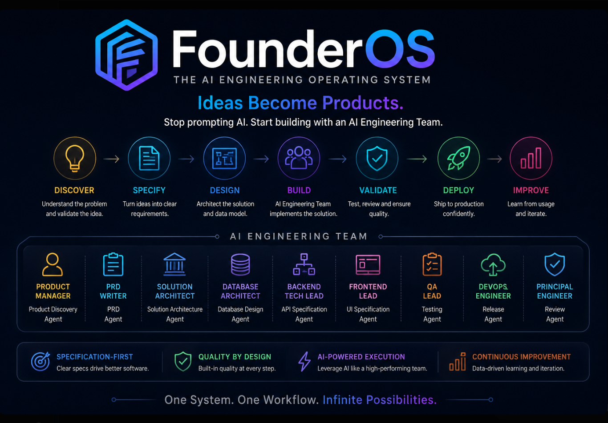

# 🚀 FounderOS

<div align="center">



### **Ideas Become Products.**

**The AI Engineering Operating System**

> **Stop prompting AI. Start engineering with AI.**

Build production-grade software through **Specification-Driven AI Engineering (SDAE)**.

</div>

---

## ✨ Why FounderOS?

AI coding tools have dramatically reduced the cost of writing code.

But software development is more than writing code.

The difficult questions still remain:

- What should we build?
- Why should we build it?
- What should we **not** build?
- What architecture should we choose?
- How should the business domain be modeled?
- How should APIs evolve?
- How do we build securely?
- How do we break work into small, reviewable changes?
- How do we validate AI-generated software?

FounderOS addresses the **engineering process around AI — not just code generation**.

### Traditional AI-assisted development

```text
Human
  │
  ▼
Prompt
  │
  ▼
AI
  │
  ▼
Code
```

### FounderOS

```text
Product Intent
      │
      ▼
Product Discovery
      │
      ▼
Specification
      │
      ▼
Architecture
      │
      ▼
Implementation Plan
      │
      ▼
AI Engineering Agents
      │
      ▼
Incremental Implementation
      │
      ▼
Validation
      │
      ▼
Production Software
```

---

# 🎯 Vision

FounderOS enables founders and small engineering teams to build software with the discipline of a world-class engineering organization.

Instead of treating AI as a code generator, FounderOS treats AI as a **team of specialized engineering roles** working through structured workflows and reusable engineering artifacts.

FounderOS provides:

- 🤖 **AI Engineering Agents**
- 📄 **Engineering Artifacts**
- 📐 **Architecture Standards**
- 📋 **Implementation Planning**
- ✅ **Quality Gates**
- 🔄 **Explicit Handoffs**
- 📚 **Reusable Templates and Playbooks**

---

# 🧠 The Core Idea

> **Great software is the result of great engineering systems — not better prompts.**

AI makes software development faster.

FounderOS provides the engineering system that tells AI **how to work**.

```text
Think
  ↓
Discover
  ↓
Specify
  ↓
Design
  ↓
Plan
  ↓
Build
  ↓
Validate
  ↓
Ship
  ↓
Learn
```

---

# 🏗️ AI Engineering Organization

FounderOS organizes AI capabilities around **engineering roles**, not AI vendors.

The framework is intentionally tool-agnostic and can work alongside Kiro, Cursor, Claude Code, ChatGPT, Gemini, or future AI development tools.

## Product

| Engineering Role | Agent | Status |
|---|---|---|
| 👨‍💼 Senior Product Manager | Product Discovery Agent | ✅ |
| 📋 Product Manager | PRD Agent | ✅ |

## Architecture

| Engineering Role | Agent | Status |
|---|---|---|
| 🏛 Staff Engineer | Solution Architecture Agent | ✅ |
| 🗄 Database Architect | Database Design Agent | ✅ |
| 🧩 Domain Architect | Domain Modeling Agent | ✅ |
| 🔌 API Architect | API Specification Agent | ✅ |
| 🔐 Principal Security Engineer | Security Architecture Agent | ✅ |

## Engineering

| Engineering Role | Agent | Status |
|---|---|---|
| 📋 Staff Engineer / Engineering Manager | Implementation Planning Agent | ✅ |
| 💻 Senior Backend Engineer | Backend Module Implementation Agent | ✅ |
| 🎨 Senior Frontend Engineer | Frontend Module Implementation Agent | ✅ |
| 🤖 AI Platform Engineer | AI Module Implementation Agent | ✅ |
| 🧪 QA Lead | Testing Agent | ✅ |
| 🔍 Principal Engineer | Code Review Agent | ✅ |
| 🚀 DevOps Engineer | Release Agent | ✅ |

---

# 📦 Engineering Artifacts

FounderOS agents collaborate through **structured engineering artifacts**.

```text
Agent
  │
  ▼
Engineering Artifact
  │
  ▼
Next Agent
```

Examples:

| Agent | Artifact |
|---|---|
| Product Discovery | Product Discovery Document |
| PRD | Product Requirements Document |
| Solution Architecture | Architecture Document |
| Database Design | Database Design Document |
| Domain Modeling | Domain Model |
| API Specification | API / OpenAPI Specification |
| Security Architecture | Security Architecture |
| Implementation Planning | Implementation Plan |
| Backend Implementation | Backend Module |
| Frontend Implementation | Frontend Module |

This creates a traceable engineering workflow instead of a collection of disconnected prompts.

---

# 🔄 FounderOS Engineering Loop

```text
                    💡
                  IDEA
                    │
                    ▼
              🔍 DISCOVER
                    │
                    ▼
              📄 SPECIFY
                    │
                    ▼
              🏛 DESIGN
                    │
                    ▼
              📋 PLAN
                    │
                    ▼
               🤖 BUILD
                    │
                    ▼
              🧪 VALIDATE
                    │
                    ▼
               🚀 SHIP
                    │
                    ▼
               📈 LEARN
                    │
                    └──────────────► Improve
```

The goal isn't to eliminate engineering judgment.

The goal is to make good engineering judgment **repeatable**.

---

# 🚫 What FounderOS Is Not

FounderOS is **not**:

- ❌ Another AI coding assistant
- ❌ Another collection of random prompts
- ❌ A replacement for Kiro, Cursor, Claude Code, or ChatGPT
- ❌ A framework locked to a specific AI vendor
- ❌ A "generate my entire application" workflow

FounderOS sits **above** these tools.

It defines **how AI participates in software engineering**.

---

# 📁 Repository Structure

```text
FounderOS/
│
├── README.md
│
├── docs/
│   ├── vision.md
│   ├── workflow.md
│   └── principles.md
│
├── agents/
│   ├── product/
│   │   ├── product-discovery-agent.md
│   │   └── prd-agent.md
│   │
│   ├── architecture/
│   │   ├── solution-architecture-agent.md
│   │   ├── database-design-agent.md
│   │   ├── domain-modeling-agent.md
│   │   ├── api-specification-agent.md
│   │   └── security-architecture-agent.md
│   │
│   ├── engineering/
│   │   ├── implementation-planning-agent.md
│   │   ├── backend-module-implementation-agent.md
│   │   └── frontend-module-implementation-agent.md
│   │
│   ├── frontend/
│   ├── ai/
│   └── shared/
│
├── templates/
├── playbooks/
├── examples/
└── assets/
```

---

# 🚦 Current Status

FounderOS is currently in **early development**.

## Foundation

- ✅ Vision
- ✅ Engineering Workflow
- ✅ Engineering Principles

## Product Agents

- ✅ Product Discovery Agent
- ✅ PRD Agent

## Architecture Agents

- ✅ Solution Architecture Agent
- ✅ Database Design Agent
- ✅ Domain Modeling Agent
- ✅ API Specification Agent
- ✅ Security Architecture Agent

## Engineering Agents

- ✅ Implementation Planning Agent
- ✅ Backend Module Implementation Agent
- ✅ Frontend Module Implementation Agent
- ✅ AI Module Implementation Agent
- ✅ Testing Agent
- ✅ Code Review Agent
- ✅ Release Agent

The role documents exist. Canonical workflow templates, operating playbooks, and a full end-to-end reference project remain to be completed. See the [FounderOS Completion Roadmap](docs/completion-roadmap.md).

---

# 🛣️ Roadmap

## Phase 1 — Foundation

- Vision
- Workflow
- Engineering Principles
- Agent framework

**Status: 🟢 Complete**

---

## Phase 2 — Product & Architecture

- Product Discovery
- PRD
- Solution Architecture
- Database Design
- Domain Modeling
- API Specification
- Security Architecture

**Status: 🟢 Complete**

---

## Phase 3 — Engineering

- Implementation Planning
- Backend Module Implementation
- Frontend Module Implementation
- AI Module Implementation
- Testing
- Code Review
- Release

**Status: 🟢 Complete**

---

## Phase 4 — Engineering Artifacts

Build canonical templates for:

- Product Discovery
- PRD
- Architecture
- Database
- Domain Model
- API
- Security
- Implementation Plan
- Testing
- ADRs

**Status: 🔵 Planned**

---

## Phase 5 — Playbooks

Create reusable playbooks for:

- Engineering
- Security
- Deployment
- Operations
- Incident Response
- AI-assisted development

**Status: 🔵 Planned**

---

## Phase 6 — Reference Products

Build complete products using FounderOS from:

```text
Idea
  ↓
Discovery
  ↓
Specification
  ↓
Architecture
  ↓
Planning
  ↓
Implementation
  ↓
Testing
  ↓
Release
```

**Status: 🔵 Planned**

---

# 💡 Engineering Principles

FounderOS follows a few fundamental principles:

- **Specification before implementation**
- **AI is part of the engineering team**
- **Product-first thinking**
- **Simplicity over unnecessary complexity**
- **Small, reviewable changes**
- **Security by design**
- **Documentation as a first-class artifact**
- **Explicit engineering decisions**
- **AI-assisted, human-approved**
- **Tools may change; engineering principles remain**

See [`docs/principles.md`](docs/principles.md).

---

# 🌟 Long-Term Vision

FounderOS is not intended to remain a prompt library.

The long-term vision is an **AI Engineering Operating System** where specialized AI engineering agents collaborate through structured artifacts, quality gates, and explicit handoffs.

Eventually, the workflow could look like:

```bash
founderos init
founderos discover
founderos specify
founderos architect
founderos plan
founderos implement
founderos test
founderos review
founderos release
```

The CLI is a future direction. The current focus is building the methodology and proving it with real projects.

---

# 🤝 Building in Public

FounderOS is an early-stage experiment.

The goal is to explore a simple question:

> **What happens when we give AI not just coding capabilities, but the engineering process of a high-performing software organization?**

The framework is evolving through real projects, experiments, and feedback.

Ideas, criticism, contributions, and experiments are welcome.

---

# ⭐ The FounderOS Thesis

> **Don't give AI a prompt. Give AI an engineering system.**

AI can generate code.

FounderOS provides the **context, process, constraints, architecture, artifacts, and quality gates** around that code.

---

<div align="center">

## **Ideas Become Products.**

### Think • Specify • Build • Validate • Scale

**FounderOS — The AI Engineering Operating System**

</div>
